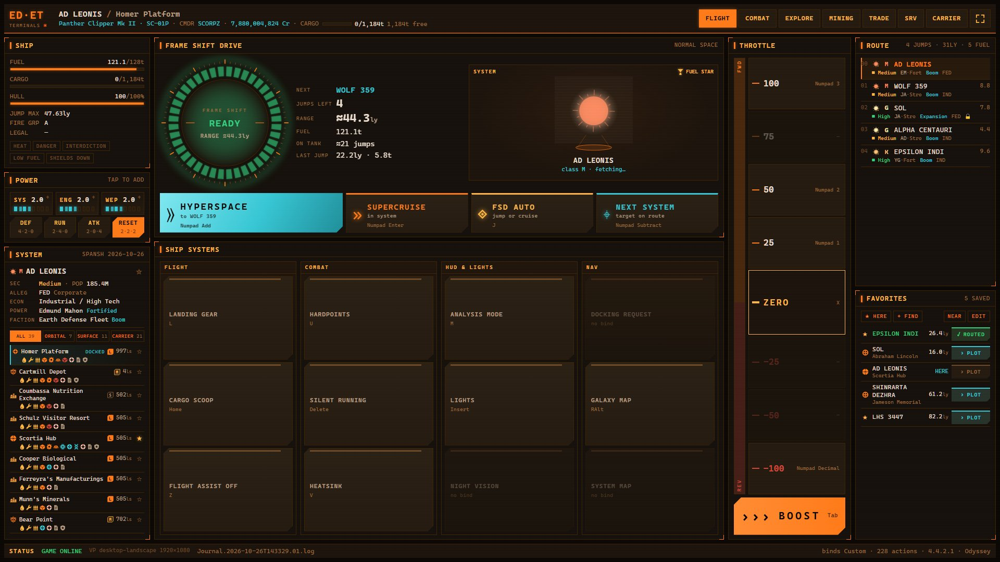
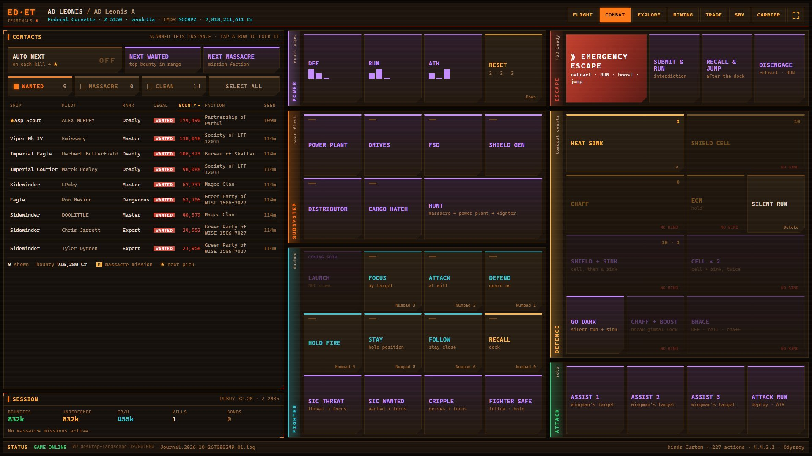
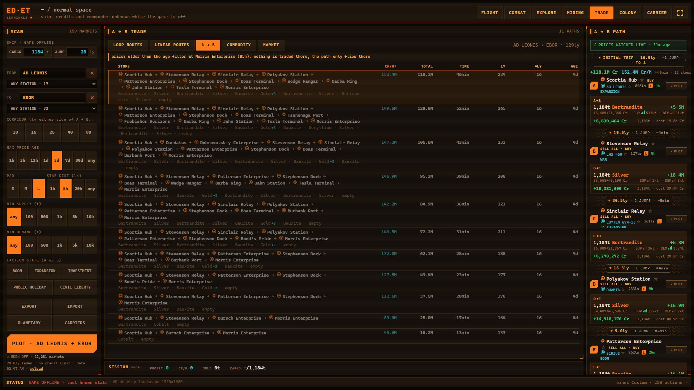
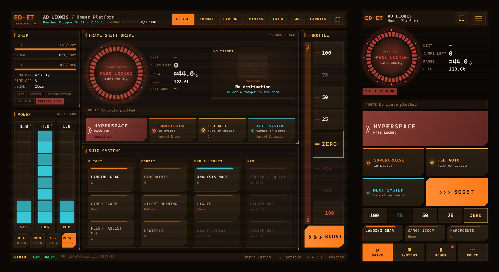

<p align="center">
  
</p>

<h1 align="center">EliteTerminals</h1>

<p align="center">
  <b>A second-screen cockpit for Elite Dangerous.</b><br />
  Live ship telemetry, one-tap ship controls, a combat console and a trade-route planner,<br />
  on any tablet, phone or spare monitor, in the look of the in-game HUD.
</p>

<p align="center">
  
  
  
  
</p>



EliteTerminals runs a small server on the PC where you play. It follows the game's journal files as they
are written and serves a web panel to any device on your local network. There is nothing to install on the
tablet or phone: open a browser (or add the panel to the home screen) and it updates live, about ten times
a second.

## Features

**FLIGHT**
- Frame Shift Drive ring with live state: ready, charging, jumping, supercruise, mass locked, cooldown.
- Hyperspace, supercruise, FSD auto and next-system buttons, plus a vertical throttle with boost.
- Power distributor with tap-to-add pips and DEF / RUN / ATK presets that read the game's real pip
  state and press keys until it matches.
- Ship systems in four groups (flight, combat, HUD & lights, nav), lit by the game's status flags.
- Fuel, cargo, hull and laden jump range, plus legal state and warnings (heat, danger, interdiction, low fuel).
- Target hologram and route list with star class, fuel stars, jump distance, security and powerplay,
  enriched from Spansh.

**COMBAT**



- **Contacts** scanned in the current instance with pilot, rank, legal status, bounty and faction. Sort by any
  column (highest bounty first by default), filter WANTED / MASSACRE / CLEAN, and tap a row to lock that ship
  in the game.
- **NEXT WANTED**, **NEXT MASSACRE** and **AUTO NEXT** (after every kill): one quick lap of the targets in range,
  then straight to the best one (a ship of your massacre target faction, else the highest bounty). The next
  pick is marked ★, and ships that left sensor range are dimmed.
- **Session**: bounties, unredeemed vouchers, Cr/h, kills, combat bonds, stacked massacre progress per giving
  faction (missions taken in earlier sessions included) and how many rebuys your credits cover.
- **Console** in colour-coded groups: power presets, one-tap subsystem lock (power plant, drives, FSD, shield
  generator, distributor, cargo hatch), fighter orders without a numpad, escape (emergency jump, submit & run,
  recall & jump), defence (heat sink, shield cell, chaff, ECM, silent running, combos) and wing assist.
- Macros press one key at a time and wait for the game to confirm each step (status flags, pips, the targeted
  ship and subsystem) before the next. Tap a running macro again to stop it.
- Phones get four pages (TARGETS, ATTACK, FIGHTER, SURVIVE); the iPad keeps a narrow targets column beside
  the whole console.

**TRADE**



- Scans the markets around you (10 to 80 ly) and ranks **loop routes** (A → B → A) and **linear routes**
  (up to five stops) by Cr/t, total profit, Cr/h or profit %.
- Mixed cargo loads that fill your hold within your stock, demand and credit limits.
- Filters for price age, landing pad, distance from the star, minimum supply/demand, faction state
  (Boom, Expansion…), planetary stations and carriers.
- Commodity finder, the market of the station you are docked at (from your own `Market.json`),
  visited-market history and session profit.
- Tap a station or system name to copy it to the **PC's** clipboard, ready to paste into the galaxy map.

**Everywhere**



- Six layout classes (phone, tablet and monitor, each in landscape and portrait) with no scrolling and
  no cut-off text.
- Tap the logo for a QR code of the PC's LAN address, so any device can connect without typing an IP.
- Installable as a full-screen web app (Android, iPadOS and iOS "Add to Home Screen"), with a reload button
  since home-screen apps have no browser bar.
- Haptic feedback on touch devices.

> EXPLORE, MINING, SRV and CARRIER tabs are planned. See the [roadmap](#roadmap).

## How it works

```
 Elite Dangerous ──writes──▶ Journal.*.log, Status.json, Cargo.json, NavRoute.json, Market.json
                                       │  (read-only)
                                       ▼
                              EliteTerminals server  ◀── Spansh (systems, stations, prices)
                              Node 24 · Fastify · WebSocket
                                       │  LAN, port 8420
                ┌──────────────────────┼──────────────────────┐
                ▼                      ▼                      ▼
             tablet                  phone              second monitor
                │ tap a button
                ▼
   server looks the action up in YOUR key bindings ──▶ focuses the game ──▶ sends the key press
```

- **Read-only.** The server never changes or deletes any game file.
- **Your own bindings.** Commands come from your active `.binds` preset and are sent as scancodes to the game
  window. An action with no key bound shows `no bind` and stays disabled. If the game window can't be
  focused, the command is refused, so no key press goes to another program.
- **Public data.** Galaxy and market data come from [Spansh](https://spansh.co.uk), one request at a time,
  cached on disk.

## Requirements

- Windows 10 or 11 with Elite Dangerous (Horizons or Odyssey).
- [Node.js 24](https://nodejs.org/) or newer.
- The tablet or phone on the same network as the PC.

## Getting started

```bash
git clone https://github.com/helgg/EliteTerminals.git
cd EliteTerminals
npm install
npm run build      # builds the web UI into web/dist
npm start          # serves http://0.0.0.0:8420 and logs the LAN addresses
```

1. Start the game (or not: the panel shows your last known state when the game is closed).
2. On the PC, open `http://localhost:8420`, tap the **ED·ET** logo and scan the QR code with your tablet or phone.
3. If the device can't connect, allow port **8420** for private networks in Windows Defender Firewall.
4. For full screen, use the ⛶ button. On an iPhone, use **Share → Add to Home Screen** and open the panel from there.

### Configuration

All optional, set as environment variables before `npm start`:

| Variable | Default | Purpose |
|---|---|---|
| `PORT` | `8420` | HTTP / WebSocket port |
| `HOST` | `0.0.0.0` | Interface to listen on |
| `ED_JOURNAL_DIR` | `%USERPROFILE%\Saved Games\Frontier Developments\Elite Dangerous` | Journal folder |
| `ED_BINDINGS_DIR` | `%LOCALAPPDATA%\Frontier Developments\Elite Dangerous\Options\Bindings` | Key bindings folder |
| `ED_GAME_DIR` | found through Steam | Game install folder, used for the built-in control schemes |
| `ET_CACHE_DIR` | `%LOCALAPPDATA%\EliteTerminals` | Spansh cache and market history |

## Development

```bash
npm run dev:server   # server with reload on :8420
npm run dev:web      # Vite on :5173, proxied to the server
npm test             # server tests, replaying recorded journals in server/test/fixtures
npm run check        # TypeScript + svelte-check
```

Open `http://localhost:8420/lab.html` to see the live panel at every layout class at once, with a check for
clipped text. Add `?tab=combat` (and `&page=survive` for a phone page) to open every frame on that screen.

| Path | What it holds |
|---|---|
| `shared/` | State model (`EdState`) and the WebSocket protocol |
| `server/src/reducer.ts` | Journal event → state (pure and tested) |
| `server/src/reader.ts` | Follows the newest journal and the companion JSON files |
| `server/src/binds.ts`, `controls.ts`, `input.ts` | Key bindings → scancodes → game window |
| `server/src/combat.ts` | Contacts, massacre missions, bounties and bonds, fighter, consumables |
| `server/src/trade/` | Market scan, route engine (loops, linear chains, mixed loads) |
| `server/src/galaxy.ts` | Spansh system lookups with a disk cache |
| `web/src/hud.css` | Elite HUD design tokens |
| `web/src/screens/` | FLIGHT, COMBAT and TRADE screens |
| `web/src/lib/macros.svelte.ts` | Multi-key macros, each step checked against the game's state |
| `web/src/lib/` | HUD components: FSD ring, pips, throttle, hologram, panels |

## Roadmap

- [x] FLIGHT: telemetry, commands, power presets, route and target
- [x] TRADE: loop and linear routes, commodity finder, local market, session
- [x] Layouts for phone, tablet and monitor, QR connect, full-screen app
- [ ] TRADE layouts for phones and tablets
- [ ] Live prices from EDDN with a local database
- [x] COMBAT: contacts by bounty, target picking, massacre missions, session, console of checked macros
- [ ] SRV screen
- [ ] EXPLORE and MINING screens
- [ ] CARRIER screen

## Disclaimer

EliteTerminals is an unofficial fan project and is not affiliated with or endorsed by Frontier Developments.
Elite Dangerous is a trademark of Frontier Developments plc. All panel art is drawn in code; no game assets are used.

## License

[GPL-3.0](LICENSE)
