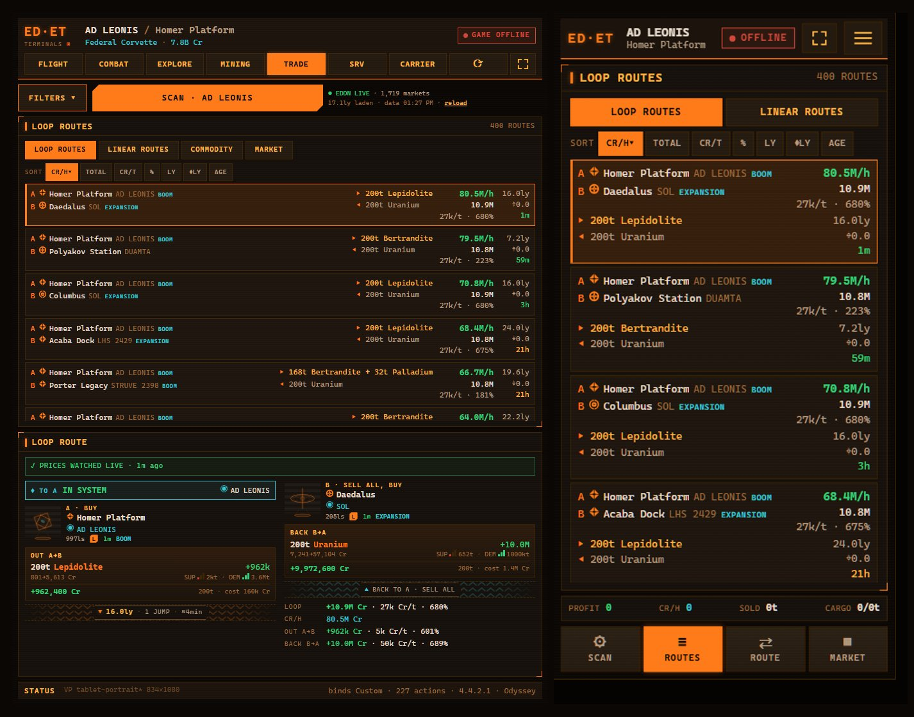
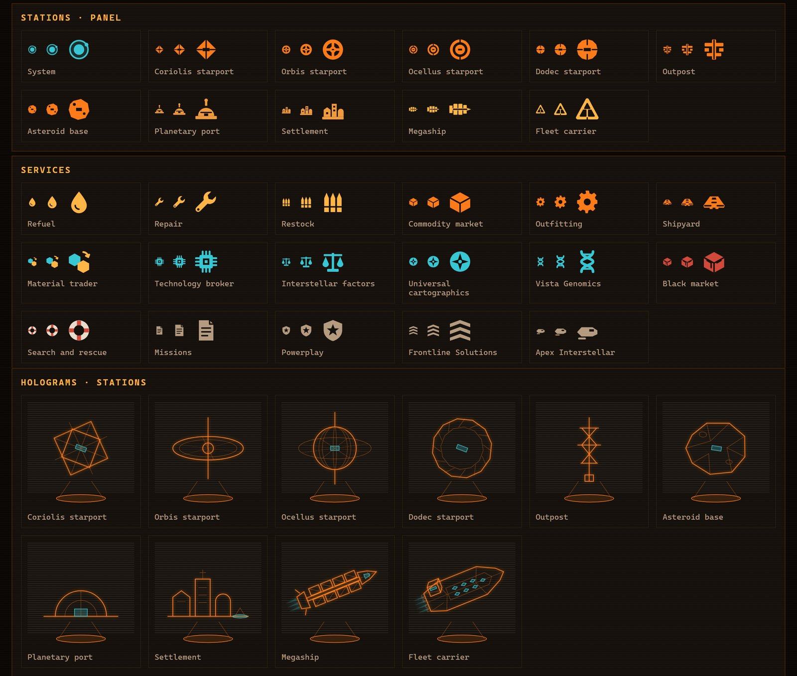

<p align="center">
  
</p>

<h1 align="center">EliteTerminals</h1>

<p align="center">
  <b>A second-screen cockpit for Elite Dangerous.</b><br />
  Live ship telemetry, one-tap ship controls, favourite destinations with one-tap route plotting,<br />
  a combat console and a trade-route planner with pinned routes,<br />
  on any tablet, phone or spare monitor, in the look of the in-game HUD.
</p>

<p align="center">
  
  
  
  
</p>


EliteTerminals runs a small server on the PC where you play. It follows the game's journal files as they
are written and serves a web panel to any device on your local network. There is nothing to install on the
tablet or phone: open a browser (or add the panel to the home screen) and it updates live, about ten times
a second.

## Features

**FLIGHT**

- **Favourites with one-tap route plotting.** Save the system you are in (★ HERE), find any system by name
  (+ FIND), or star a station in the SYSTEM panel. Tap **PLOT** and the panel opens the galaxy map, searches the
  system, picks it and plots the route, then closes the map once the game confirms a route that ends there.
  Each favourite shows its distance and turns **ROUTED** when your route ends there; sort by distance with NEAR.
  The game keeps its own bookmarks on Frontier's servers, out of reach, so the favourites live on your PC.
- **Every station in the system** in the SYSTEM panel: type icon, largest pad, distance from the star and services,
  filtered ALL / ORBITAL / SURFACE / CARRIER, with the station you are docked at on top.
- Frame Shift Drive ring with live state: ready, charging, jumping, supercruise, mass locked, cooldown.
- Hyperspace, supercruise, FSD auto and next-system buttons, plus a vertical throttle with boost.
- Power distributor with tap-to-add pips and DEF / RUN / ATK presets that read the game's real pip
  state and press keys until it matches. On monitors the pips are compact bars, leaving the height to the system's
  station list.
- Ship systems in four groups (flight, combat, HUD & lights, nav), lit by the game's status flags.
- Fuel, cargo, hull and laden jump range, plus legal state and warnings (heat, danger, interdiction, low fuel).
- Target hologram and route list with star class, fuel stars, jump distance, security and powerplay,
  enriched from Spansh. Station targets show the landing pad and services; ringed planets show their rings.
- Monitors split the right-hand column between the route and the favourites; tablets open the favourites from the
  route strip (★ FAV), and phones switch between ROUTE and FAVORITES on the route page.

**COMBAT**


- **Contacts** scanned in the current instance with pilot, rank, legal status, bounty and faction. Sort by any
  column (highest bounty first by default), filter WANTED / MASSACRE / CLEAN, and tap a row to lock that ship
  in the game.
- **NEXT WANTED**, **NEXT MASSACRE** and **AUTO NEXT** (after every kill): one quick lap of the targets in range,
  then straight to the best one (a ship of your massacre target faction, else the highest bounty). The next
  pick is marked ★, and ships that left sensor range are dimmed.
- **Session**: bounties, unredeemed vouchers, Cr/h, kills, combat bonds, stacked massacre progress per giving
  faction (missions taken in earlier sessions included) and how many rebuys your credits cover.
- **Console** in colour-coded groups: power presets, one-tap subsystem lock (power plant, drives, FSD, shield
  generator, distributor, cargo hatch), fighter orders without a numpad, escape (emergency jump, submit & run,
  recall & jump), defence (heat sink, shield cell, chaff, ECM, silent running, combos) and wing assist.
- Macros press one key at a time and wait for the game to confirm each step (status flags, pips, the targeted
  ship and subsystem) before the next. Tap a running macro again to stop it.
- Phones get four pages (TARGETS, ATTACK, FIGHTER, SURVIVE); the iPad keeps a narrow targets column beside
  the whole console.

**TRADE**


- Scans the markets around you, or around **any system you pick** (FROM, with name search), 10 to 80 ly out,
  and ranks **loop routes** (A → B → A) and **linear routes** (up to five stops) by Cr/t, total profit, Cr/h or profit %.
- **Live prices**: while the server runs it listens to [EDDN](https://github.com/EDCD/EDDN) and keeps every market
  it hears in a local SQLite database, together with Spansh scans and your own `Market.json`. Once a region has been
  scanned, the next scans there come from the database in a fraction of a second, with the newest prices.
- **Route watch**: the route you pick is priced again whenever one of its markets gets new prices, and a warning
  shows what changed (profit per ton, stock, demand, commodity gone). Prices of visited and watched markets are kept
  for 7 days.
- **Pinned routes**: tap ◇ on a route to pin it. Pinned routes keep a cyan rail in every later scan, and
  **PINNED** lists only them, including the ones a new scan left out (marked *not in this scan*, with the figures
  they had when last seen). Pins are kept on the PC, so every device sees the same ones.
- **Favourites from a route**: the ☆ beside each station and system of a route saves it to the FLIGHT favourites,
  ready for one-tap plotting.
- Mixed cargo loads that fill your hold within your stock, demand and credit limits.
- Filters for price age, landing pad, distance from the star, minimum supply/demand, faction state
  (Boom, Expansion…), planetary stations and carriers.
- Commodity finder, the market of the station you are docked at (from your own `Market.json`),
  visited-market history and session profit.
- Tap a station or system name to copy it to the **PC's** clipboard, ready to paste into the galaxy map.
- On tablets the filters open in a drawer and routes show as cards, with the route detail beside them (landscape)
  or underneath (portrait). Standing up, a loop reads side by side: A, the jump lane, B, filling the panel.
  Phones get four pages: SCAN, ROUTES, ROUTE and MARKET.



**Everywhere**


- Six layout classes (phone, tablet and monitor, each in landscape and portrait) with no scrolling and
  no cut-off text.
- Tap the logo for a QR code of the PC's LAN address, so any device can connect without typing an IP.
- Installable as a full-screen web app (Android, iPadOS and iOS "Add to Home Screen"), with a reload button
  since home-screen apps have no browser bar.
- Haptic feedback on touch devices.

**Icons and holograms**



- Filled icons for every kind of station, landing pad size, station services, star classes and planet types,
  in the HUD palette. Fuel stars carry an amber notch.
- Holograms for each station type (the Coriolis and Dodec turn with their docking slot), carriers and
  megaships, stars, planets (with rings when they have them), nav beacons, extraction sites, conflict zones
  and other signals.
- Open `http://localhost:8420/?sheet=icons` to see the whole set.

> EXPLORE, MINING and CARRIER show a *coming soon* screen for now. See the [roadmap](#roadmap).

## How it works

```
 Elite Dangerous ──writes──▶ Journal.*.log, Status.json, Cargo.json, NavRoute.json, Market.json
                                       │  (read-only)
                                       ▼
                              EliteTerminals server  ◀── Spansh (systems, stations, prices)
                              local price database   ◀── EDDN (live prices from other players)
                              Node 24 · Fastify · WebSocket
                                       │  LAN, port 8420
                ┌──────────────────────┼──────────────────────┐
                ▼                      ▼                      ▼
             tablet                  phone              second monitor
                │ tap a button
                ▼
   server looks the action up in YOUR key bindings ──▶ focuses the game ──▶ sends the key press
```

- **Read-only.** The server never changes or deletes any game file.
- **Your own bindings.** Commands come from your active `.binds` preset and are sent as scancodes to the game
  window. An action with no key bound shows `no bind` and stays disabled. If the game window can't be
  focused, the command is refused, so no key press goes to another program.
- **Plotting a route** is a checked macro too: it waits for the galaxy map to open (Status.json), types the name by
  pasting it from the PC's clipboard, and only reports success when the game writes a route that ends at that system.
  If a step fails, the map stays open with the name on the clipboard, so you can finish by hand.
- **Public data.** Galaxy and market data come from [Spansh](https://spansh.co.uk), one request at a time,
  cached on disk, and live market prices from the [EDDN](https://github.com/EDCD/EDDN) relay while the server runs.

## Requirements

- Windows 10 or 11 with Elite Dangerous (Horizons or Odyssey).
- [Node.js 24](https://nodejs.org/) or newer.
- The tablet or phone on the same network as the PC.
- To plot routes from the panel: a keyboard key for **Galaxy Map** in the game's controls.

## Getting started

```bash
git clone https://github.com/helgg/EliteTerminals.git
cd EliteTerminals
npm install
npm run build      # builds the web UI into web/dist
npm start          # serves http://0.0.0.0:8420 and logs the LAN addresses
```

1. Start the game (or not: the panel shows your last known state when the game is closed).
2. On the PC, open `http://localhost:8420`, tap the **ED·ET** logo and scan the QR code with your tablet or phone.
3. If the device can't connect, allow port **8420** for private networks in Windows Defender Firewall.
4. For full screen, use the ⛶ button. On an iPhone, use **Share → Add to Home Screen** and open the panel from there.

### Configuration

All optional, set as environment variables before `npm start`:

| Variable | Default | Purpose |
|---|---|---|
| `PORT` | `8420` | HTTP / WebSocket port |
| `HOST` | `0.0.0.0` | Interface to listen on |
| `ED_JOURNAL_DIR` | `%USERPROFILE%\Saved Games\Frontier Developments\Elite Dangerous` | Journal folder |
| `ED_BINDINGS_DIR` | `%LOCALAPPDATA%\Frontier Developments\Elite Dangerous\Options\Bindings` | Key bindings folder |
| `ED_GAME_DIR` | found through Steam | Game install folder, used for the built-in control schemes |
| `ET_CACHE_DIR` | `%LOCALAPPDATA%\EliteTerminals` | Spansh cache, market history, favourites (`favorites.json`), pinned routes (`trade-pins.json`) and the price database (`prices.db`) |
| `ET_EDDN` | `1` | Set to `0` to stop listening to EDDN |

## Development

```bash
npm run dev:server   # server with reload on :8420
npm run dev:web      # Vite on :5173, proxied to the server
npm test             # server tests, replaying recorded journals in server/test/fixtures
npm run check        # TypeScript + svelte-check
```

Open `http://localhost:8420/lab.html` to see the live panel at every layout class at once, with a check for
clipped text. Add `?tab=combat` (and `&page=survive` for a phone page) to open every frame on that screen.

| Path | What it holds |
|---|---|
| `shared/` | State model (`EdState`) and the WebSocket protocol |
| `server/src/reducer.ts` | Journal event → state (pure and tested) |
| `server/src/reader.ts` | Follows the newest journal and the companion JSON files |
| `server/src/binds.ts`, `controls.ts`, `input.ts` | Key bindings → scancodes → game window |
| `server/src/combat.ts` | Contacts, massacre missions, bounties and bonds, fighter, consumables |
| `server/src/trade/` | Market scan, route engine (loops, linear chains, mixed loads), reference search |
| `server/src/prices/` | Local price database (SQLite), EDDN listener, route watch |
| `server/src/favorites.ts`, `tradePins.ts` | Favourite destinations and pinned trade routes, kept on disk |
| `server/src/galaxy.ts` | Spansh system lookups with a disk cache, and rings of the targeted body |
| `web/src/hud.css` | Elite HUD design tokens |
| `web/src/screens/` | FLIGHT, COMBAT and TRADE screens |
| `web/src/lib/macros.svelte.ts` | Multi-key macros (combat, power, route plotting), each step checked against the game's state |
| `web/src/lib/` | HUD components: FSD ring, pips, throttle, hologram, panels, icons |

## Roadmap

- [x] FLIGHT: telemetry, commands, power presets, route and target
- [x] TRADE: loop and linear routes, commodity finder, local market, session
- [x] Layouts for phone, tablet and monitor, QR connect, full-screen app
- [x] TRADE layouts for phones and tablets
- [x] Live prices from EDDN with a local database, routes from any system, route watch
- [x] COMBAT: contacts by bounty, target picking, massacre missions, session, console of checked macros
- [x] Icons and holograms: stations, pads, services, stars, planets with rings, signals
- [x] FLIGHT favourites with one-tap route plotting, every station of the system with filters
- [x] TRADE pinned routes, favourites from a route, side-by-side loop on portrait screens
- [ ] MINING screen (ship first, then surface vehicles)
- [ ] EXPLORE screen
- [ ] CARRIER screen

## Disclaimer

EliteTerminals is an unofficial fan project and is not affiliated with or endorsed by Frontier Developments.
Elite Dangerous is a trademark of Frontier Developments plc. All panel art is drawn in code; no game assets are used.

## License

[GPL-3.0](LICENSE)
